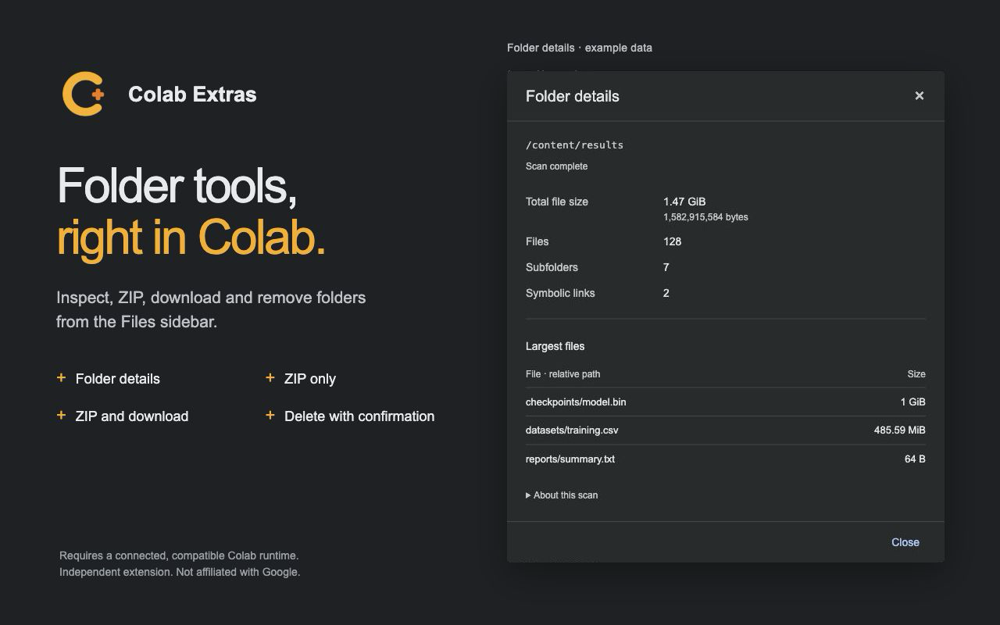

<p align="center"></p>

# Colab Extras

Everyday folder tools for Google Colab. Right-click a folder in the Files sidebar to inspect it, create a ZIP, download it, or delete a non-empty folder.

**Version 0.6.2 · Chrome 120+ · Independent extension, not affiliated with Google.**

| Action | What it does |
| --- | --- |
| Folder details | Shows total file size, file and subfolder counts, symbolic links, and the 10 largest files. |
| ZIP only | Saves a ZIP beside the selected folder, preserving existing archives with numbered filenames. |
| ZIP and download | Creates the ZIP and starts its download. |
| Delete folder and contents | Permanently removes the selected folder after confirming its exact path. |

ZIP actions start immediately. Progress appears beside the folder; right-click again to cancel an active ZIP. Folder details follows Colab's light or dark theme and supports scan cancellation.



## Install in Chrome

The extension is **not yet published in the Chrome Web Store**. To install the current build:

1. [Download version 0.6.2](https://github.com/luisdrita/colab-extras/raw/refs/heads/main/dist/colab-extras-0.6.2.zip) and extract it into a permanent folder.
2. Open `chrome://extensions` and enable **Developer mode**.
3. Click **Load unpacked** and select the extracted folder containing `manifest.json`.
4. Refresh Colab, connect a compatible hosted runtime, and open the **Files** sidebar.
5. Right-click a folder and choose an action.

If you clone this repository, load its `extension/` folder instead. After updating, reload the extension in Chrome and refresh your Colab tab. Do not enable duplicate copies.

## Runtime requirements

Requires Chrome 120+, a connected hosted Colab runtime with Python 3.8+, and access to independent Jupyter terminals. Terminal availability may depend on your Colab plan and runtime configuration. Free-tier compatibility has not been verified.

Operations run in a separate process on the **same Colab virtual machine**. They use its CPU, memory, and disk, without adding or queueing a notebook cell. Compression finishes before the archive is downloaded. No setup cell, API key, external compression service, or extension account is required.

Keep the Colab tab and runtime connected. ZIP creation needs sufficient free space and a writable parent folder. Colab may buffer a downloaded archive in the browser; multi-gigabyte downloads have not been validated. Files changing during an operation can cause errors or inconsistent results; this is not a filesystem snapshot. Unsupported terminal access produces an error without running a notebook cell.

## Deletion and scanning

**Deletion is permanent and bypasses Trash, including on mounted drives. There is no undo.** Use it only after checking the confirmed path. Deletion cannot be cancelled after confirmation and may be partial if permissions or connectivity fail.

Deletion is limited to subfolders of `/content`. Runtime roots, standard Drive roots, mount points, staging folders, and paths reached through symbolic-link parents are protected. Symbolic links inside the selected folder are removed as links, without deleting their targets. Stop other processes writing to a folder before deleting it.

Folder details reads metadata, includes hidden files and empty folders, and counts symbolic links without traversing their targets. Size means logical regular-file bytes, not allocated disk space; hard-linked paths count separately. Special files and extension staging folders are excluded. Unreadable or changing entries are reported as incomplete totals.

Mounted-Drive operations and the latest installed build still need live verification. Colab's internal page and terminal interfaces can change. See [Testing](TESTING.md) for the verified scope.

## Privacy

The extension runs only on `https://colab.research.google.com/*` and uses Colab's existing authenticated runtime connection. It has no ads, analytics, telemetry, credential store, or developer-operated file service. Files and operation data are not sent to the developer. Completed jobs clean up their staging files when possible; disconnections can leave temporary files. ZIPs and downloads remain until you remove them.

Read the [privacy policy](PRIVACY.md). A copy is included in the extension popup.

## Develop and test

No npm packages are required. Use Python 3.8+ and Node.js 20+:

```sh
python3 build.py
python3 -m unittest discover -s tests -p 'test_*.py'
node --test tests/core.test.cjs
node --check extension/colab-zip.js
```

`extension/colab-zip.js` is generated from the readable JavaScript and bundled Python in `src/`. Rebuild it after changing source files.

For the local browser harness, run `python3 -m http.server 8765 --bind 127.0.0.1` from the repository root, then open `http://127.0.0.1:8765/tests/ui.html`. Its connection and file data are simulated; it does not operate on a real Colab runtime.

## Feedback

[Open an issue](https://github.com/luisdrita/colab-extras/issues) with the extension version, Colab runtime type, action, and error message. Remove private paths, notebook contents, credentials, and other confidential data before posting.
