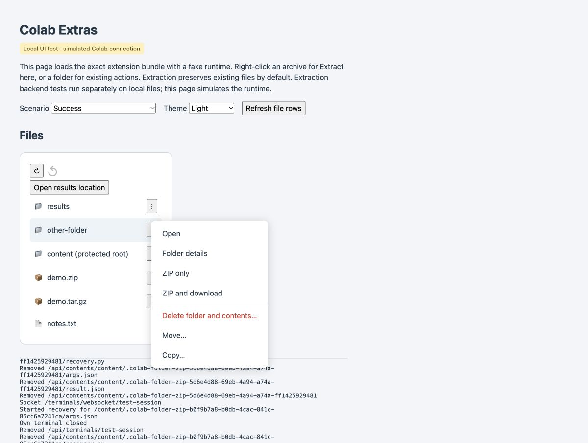

<p align="center"></p>

# Colab Extras

File tools for Google Colab, with a backwards-arrow **Undo** button beside **Refresh** in the Files sidebar. Inspect folders, create and download ZIPs, extract archives, and recover supported file changes.

**Version 0.9.5 · Chrome 120+ · Independent extension, not affiliated with Google.**

[Download version 0.9.5](https://github.com/luisdrita/colab-extras/releases/tag/v0.9.5). All 67 JavaScript tests pass; unchanged Python workers retain their 93 passing tests. Hosted Colab recovery checks passed on 0.9.0; see the [verification record](TESTING.md) for the exact browser coverage and remaining live checks.



*Preview uses simulated file results; it is not evidence of a live Colab operation.*

The [Chrome Web Store](https://chromewebstore.google.com/detail/colab-extras/aeghdoedemnfdoagpopjdbopnlphaaad) may still offer an earlier version. Upload, review, and publication are separate stages. See [verification status](TESTING.md) for the tested scope and remaining live checks.

While ZIP creation, downloads, extraction, deletion, or folder scans run, only the Colab-style loading circle is shown beside the item. Operation names and percentages remain available to assistive technology and in tooltips; the circle disappears at completion without leaving a message. Error messages remain visible.

## Undo coverage

| Action | Recovery behaviour |
| --- | --- |
| ZIP only | Removes the generated archive from its visible location after verifying its identity, metadata, and SHA-256 content hash. |
| ZIP and download | Runtime ZIP recovery plus separately tracked optional browser-download cancellation/removal in the extension popup. |
| Extract here | Removes unchanged extracted files and empty created folders. If replacement is enabled, restores retained originals. |
| Delete folder and contents | Moves the selected tree into recovery storage before reporting success; Undo restores it without overwriting a newly occupied path. |
| Rename / move | Restores the original path if both locations are safe. Cross-filesystem moves verify a copy and retain the source before publication. |
| Copy / create folder | Removes unchanged copies or empty created folders; later changes remain. |
| Upload / replace file | Retains original files; complete upload calls are tracked, including Colab's numbered chunks. |
| Cancellation | Attempts rollback of completed ZIP/extraction/upload changes. Conflicts and runtime loss can prevent full recovery. |
| Extension settings | Reverses preferences changed in the current tab. |
| Folder opening/closing | Reverses the latest expansion or collapse, restoring previously expanded subfolders. |
| Sidebar navigation | Returns to a previously visited sidebar location without changing Python's working directory. |

Click **Undo** beside Refresh to immediately reverse the most recent supported action: a file change, sidebar path change, folder opening or closing, or extension setting change. Each click handles one action without opening a dialog. If the latest action has a conflict, recovery preserves later edits and stops there; it does not silently skip to an older action. Successful Undo finishes without a sidebar message; conflicts and errors remain visible.

While Undo runs, its backwards arrow rotates counterclockwise until recovery and sidebar refresh finish. Repeated clicks are disabled. The icon stops on success or failure, and reduced-motion preferences are respected.

The button is grey and disabled when there is nothing to undo. Opening and closing folder rows joins the same action history; undoing a close also restores previously expanded subfolders. Undo controls are not added to right-click menus. Preferences are available in the Chrome extension popup.

The extension adds ordinary **Move…** and **Copy…** file actions. Native Colab rename and new-folder controls remain available. It also intercepts supported native Files sidebar mutations inside `/content` while active. The current integration uses Colab's internal file interfaces, which may change. Arbitrary notebook code, terminal commands, other users, operations before tracking began, and paths outside `/content` are not covered.

## Recovery storage

Recovery is scoped to the runtime. Journals live in `/content/.colab-folder-zip-undo`; retained originals, staged data, and removed outputs live in hidden `.colab-folder-zip-recovery-*` folders on the affected filesystem. They continue to use disk space and are not automatically expired in this release. Undo removes generated output from its original location by quarantining it rather than permanently destroying it.

Deleting the runtime loses its local journal and local backups. Drive copies may survive, but without the runtime journal they are not automatically recoverable through this version. Deleting recovery folders invalidates their history. Previously deleted files without a retained copy cannot be recovered retroactively. Filesystem changes from active writers can cause conflicts; pause those writers before recovery.

## Extraction

Right-click a ZIP, TAR, TAR.GZ, or TGZ and choose **Extract here**. Files are extracted beside the archive, which is retained. Existing files are preserved by default. To allow replacement, enable the setting in the **Chrome extension popup**; originals are retained first.

Archive traversal paths, links, special files, encrypted ZIPs, sparse TAR entries, and archives over 100,000 entries are rejected. Extracted files do not inherit executable permissions or ownership from the archive. Cancellation and failures attempt rollback, preserving later changes.

## Optional download management

Normal Colab downloads do not require an additional permission. For tracked downloads:

1. Open the extension popup and enable optional download management, granting Chrome's downloads permission.
2. Enable tracking in the same extension popup.
3. Use **ZIP and download**. Its operation and browser-download IDs are recorded separately.
4. Use the extension popup to cancel the tracked download or confirm permanent removal of its completed local copy.

Existing untracked downloads and copies moved or made outside the browser cannot be reliably recalled. Runtime Undo does not automatically delete a local file. Large browser downloads may require substantial memory.

## Install and develop

Load the `extension/` directory as an unpacked extension in Chrome Developer mode. Disable other copies while testing, then refresh Colab. A connected hosted runtime with Python 3.8+ and independent Jupyter terminal access is required. Unsupported terminal access fails without executing a notebook cell. Runtime CPU, memory, and disk are used by the operations.

No npm dependencies are needed. Build and test with:

```sh
python3 build.py
python3 -m unittest discover -s tests -p 'test_*.py'
node --test tests/*.test.cjs
node --check extension/colab-zip.js
```

`extension/colab-zip.js` is generated from `src/`. For the simulated browser harness, serve the repository with `python3 -m http.server 8765 --bind 127.0.0.1`, then open `http://127.0.0.1:8765/tests/ui.html`. This is a simulated runtime, not live Colab validation.

## Privacy and feedback

No analytics, ads, developer-operated file service, or extension account. File contents and recovery data stay in the user's browser, runtime, and selected mounted filesystem. Read the [privacy policy](PRIVACY.md).

[Report an issue](https://github.com/luisdrita/colab-extras/issues) with the version, action, runtime type, and error. Remove confidential paths, file contents, and credentials before posting.
